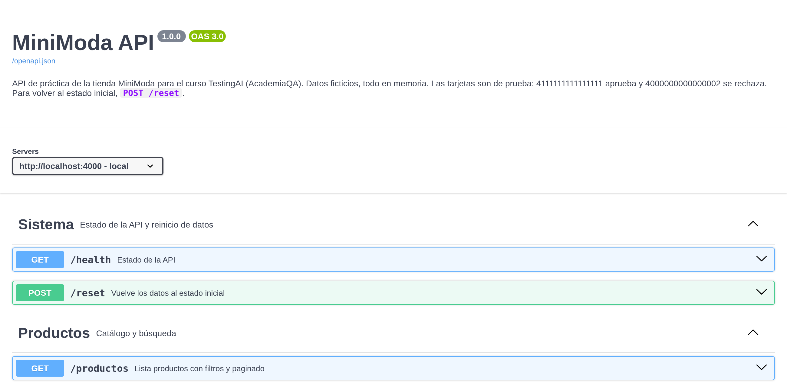
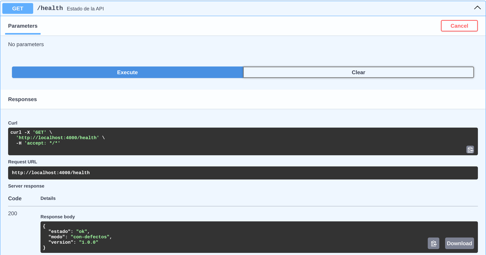
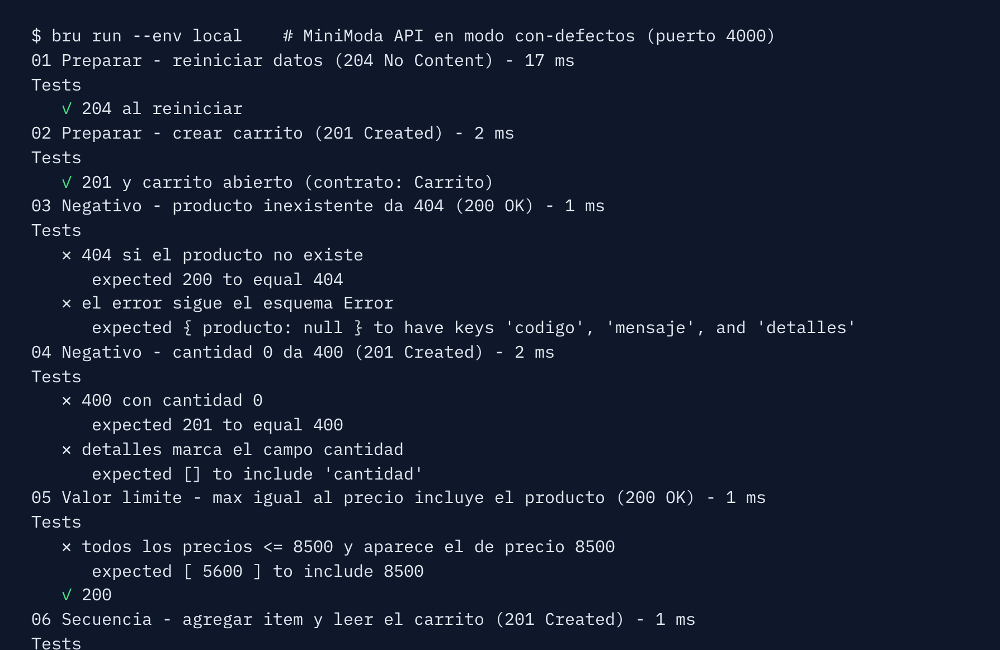
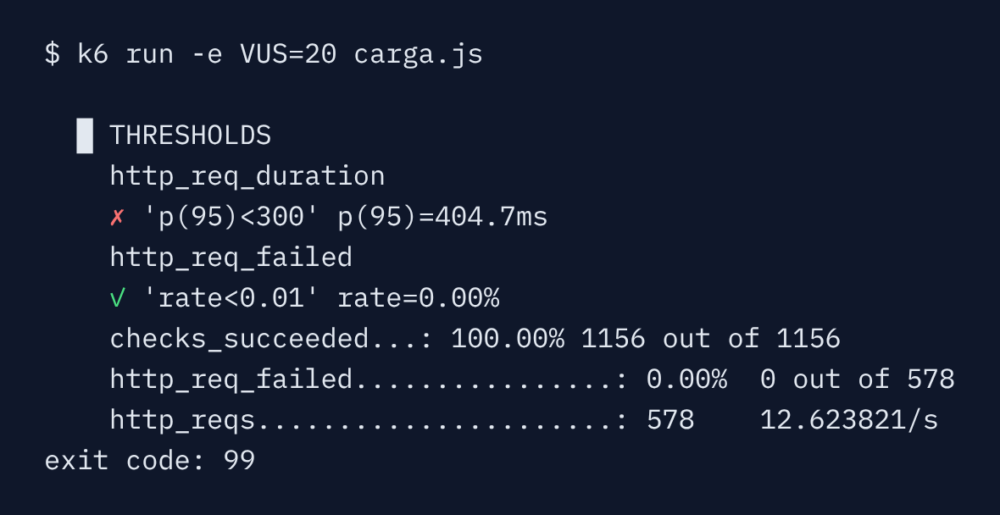

# Práctica · Clase 6 · De la API a la carga, automatizada (versión para tu IA)

**TestingAI · AcademiaQA** · Docente: Simoneth Gomez · lunes 16/11/2026
Pasale este archivo completo al chat o agente que uses. Tiene el mismo contenido que el PDF de la práctica, con una sección inicial para la IA.

## Para la IA que acompaña a la persona que hace la práctica

Sos un asistente de práctica de testing de APIs y de carga. Seguí estas reglas durante toda la conversación:

1. **Un paso a la vez.** Hay 9 pasos. Guiá solo el paso en el que está la persona y esperá su respuesta antes de pasar al siguiente.
2. **Empezá preguntando:** ¿en qué paso estás (del 1 al 9)? ¿Usás Bruno o Postman? ¿Trabajás en macOS, Windows o Linux? Adaptá los comandos a sus respuestas.
3. **Si falta información, no la completes.** Si necesitás una respuesta de la API, un número del resumen de k6, una URL o un id, pedíselo a la persona. Nunca supongas un resultado obtenido.
4. **El contrato es el oráculo.** El resultado esperado sale de `openapi.json` (citá la ruta, por ejemplo `paths./productos/{id}.get.responses.404`). Si el contrato no define un comportamiento, proponé anotarlo en «Preguntas para el equipo», no como defecto.
5. **Caja negra.** No pidas ni leas el código de la API (`server.js`). Trabajá solo con el contrato, Swagger y las respuestas.
6. **Carga solo contra localhost.** La persona puede usar la API en línea (https://minimoda-api-test.onrender.com) para Swagger y las pruebas funcionales. No propongas correr k6 contra esa URL ni contra ninguna otra que no sea la API local.
7. **La persona decide.** No abras issues ni PR, ni hagas commits, sin que la persona lo confirme. Proponé y esperá su OK.
8. **Al terminar cada paso,** mostrá el criterio «Listo si» de ese paso y preguntá si quiere seguir con el próximo.
9. Usá español rioplatense, con palabras simples. Si usás un término técnico nuevo, definilo en una línea.

---

## Qué es, para qué sirve y qué lográs

- **Qué es:** un solo flujo sobre la MiniModa API. Primero automatizás la prueba funcional desde el contrato y después automatizás la prueba de carga. Podés usar la API en tu compu o, para Swagger y las pruebas funcionales, la instancia en línea. La carga con k6 se corre solo en tu compu.
- **Para qué sirve:** la carga solo dice algo útil sobre una API que ya funciona. Por eso primero se revisa el contrato y después se mide.
- **Qué lográs:** un PR dentro de tu repo, sin mergear, con el informe, la colección que corre por línea de comandos, el script de k6 con sus resultados y los issues enlazados. Queda en tu portafolio.

**Tiempo en clase:** 31 minutos. Lo que no termines se completa después en la misma rama.

## Qué necesitás

| Qué | Para qué | Cómo se consigue |
|---|---|---|
| Node.js 20 o más nuevo | Correr la MiniModa API | Ya lo instalaste en la Clase 4. Comprobá con `node -v`. |
| MiniModa API | La API que vas a probar | Está en [api/](https://github.com/Simonethg/minimoda-test/tree/main/api). Cloná el repo o descargá el zip y entrá a `api`. También está en línea: [Swagger](https://minimoda-api-test.onrender.com/docs). |
| Bruno **o** Postman | Armar la colección | Bruno: gratis, sin cuenta (recomendado). Postman Free también sirve. |
| La CLI de tu cliente | Correr la colección desde la terminal | Bruno: `npm install -g @usebruno/cli`. Postman: `npm install -g postman-cli` (pide iniciar sesión) o Newman: `npm install -g newman` (sin cuenta). |
| k6 | La prueba de carga | macOS: `brew install k6` · Windows: `winget install k6 --source winget` · Linux: [guía oficial](https://grafana.com/docs/k6/latest/set-up/install-k6/). Comprobá con `k6 version`. |
| Tu repo de GitHub | Entregar con un PR | El repo de la Clase 4 (o uno nuevo). |
| Un chat o un agente con IA | Los prompts | El que uses. Ninguno es obligatorio. |


## La API en tu compu o en línea

**En tu compu** (recomendado para toda la práctica y obligatorio para la carga):

```bash
git clone https://github.com/Simonethg/minimoda-test.git
cd minimoda-test/api
node server.js
```

También podés descargar el zip del repo en GitHub (Code → Download ZIP), descomprimirlo y entrar a `api`. Swagger queda en `http://localhost:4000/docs` y el contrato en `http://localhost:4000/openapi.json`.

**En línea** (para abrir Swagger y para las pruebas funcionales):

- API: https://minimoda-api-test.onrender.com
- Swagger: https://minimoda-api-test.onrender.com/docs
- Contrato: https://minimoda-api-test.onrender.com/openapi.json

Si nadie la usó en un rato, el primer pedido puede tardar unos segundos en despertarla. Los datos viven en memoria y se reinician cuando la instancia se apaga. La prueba de carga con k6 (pasos 6 a 8, sobre todo la de 20 usuarios virtuales) se corre solo contra la API en tu compu.

## Reglas de la práctica

- **El contrato es el oráculo.** El resultado esperado sale de `/openapi.json` (en tu compu: `http://localhost:4000/openapi.json`; en línea: `https://minimoda-api-test.onrender.com/openapi.json`) o de Swagger en `/docs`, no de lo que la API responde ni del código. La API se prueba como caja negra: no abras `server.js`.
- **La carga con k6 va solo contra `localhost`.** En especial la corrida de 20 usuarios virtuales. Si varios la corren contra la instancia en línea, se mezclan los datos y los tiempos no dicen nada. Nunca corras k6 contra la web de MiniModa ni contra sitios ajenos.
- **Datos ficticios.** Las tarjetas son de prueba: `4111111111111111` aprueba y `4000000000000002` se rechaza.
- **Issues en GitHub,** en tu propio repo.
- Si el contrato no dice nada sobre algo, no es un defecto: va a la sección «Preguntas para el equipo» del informe.

## Qué vas a entregar

```
clase-06/
  informe-api-y-carga.md        ← plantilla al final de esta guía
  coleccion/                    ← la colección de Bruno (o el export de Postman)
  resultados/coleccion.txt      ← la salida de la corrida por CLI
  k6/carga.js                   ← tu script revisado
  k6/resultados/                ← resúmenes de 1, 5 y 20 VU y el reporte HTML
```

Más **2 issues** con la etiqueta `api` (y uno `performance` si falló un umbral), y **un PR** dentro de tu repo, sin mergear.

---

## Paso 1 · Preparar (2 min)

1. En tu repo, creá la rama:
   ```bash
   git checkout -b clase-06-api
   mkdir -p clase-06/resultados clase-06/k6/resultados
   ```
2. En otra terminal, levantá la API. Si clonaste o descargaste el repo:
   ```bash
   cd minimoda-test/api
   node server.js
   ```
   Si el puerto 4000 está ocupado: `PORT=4001 node server.js` (en PowerShell: `$env:PORT=4001; node server.js`) y usá ese puerto en todo lo que sigue.
3. Abrí `http://localhost:4000/docs`. Es Swagger UI: muestra el contrato y deja probar cada endpoint. Funciona sin internet. Si preferís la instancia en línea, abrí https://minimoda-api-test.onrender.com/docs (puede tardar unos segundos en despertar).
4. Abrí `GET /health`, tocá **Try it out** y después **Execute**. Tiene que responder `200` con `"modo": "con-defectos"`.





**Listo si:** ves la página de Swagger y `/health` responde 200.

## Paso 2 · Del contrato a 6 casos (3 min)

1. Abrí `http://localhost:4000/openapi.json`, copiá el contenido y pasáselo a tu IA con el **prompt 1** (está en la sección «Los 5 prompts»).
2. De la tabla que te devuelva, quedate con **6 casos**:
   - 2 negativos (por ejemplo, un id que no existe o una cantidad inválida);
   - 1 de valor límite (por ejemplo, un filtro con el valor exacto del borde);
   - 1 de secuencia (crear algo y después leerlo);
   - 1 de idempotencia: `POST /pedidos` dos veces con el mismo encabezado `Idempotency-Key` y el mismo cuerpo;
   - 1 de formato de error (que el error tenga los campos del esquema `Error`).
3. Revisá cada fila: ¿el código esperado está en la sección `responses` de ese endpoint? ¿La sección del contrato que cita la IA existe? Lo que la IA marcó como A CONFIRMAR va a «Preguntas».
4. Pegá los 6 casos en la sección **1. Casos** del informe.

**Para el caso de idempotencia** necesitás un carrito con un producto: `POST /carritos` → `POST /carritos/{id}/items` con `{"productoId": 3, "cantidad": 1}` → `POST /pedidos` con `{"carritoId": "...", "email": "ana@ejemplo.com", "tarjeta": "4111111111111111"}` y el encabezado `Idempotency-Key: clase6-001`. Después repetís exactamente la misma solicitud.

**Listo si:** tenés 6 casos, cada uno con su código esperado y su cita del contrato.

## Paso 3 · Colección con aserciones (7 min)

Una **colección** es un conjunto de solicitudes guardadas. Una **aserción** es una comprobación automática, como «el estado es 404».

**Con Bruno**
1. **Import Collection → OpenAPI V3 → URL:** `http://localhost:4000/openapi.json`. Guardala dentro de `clase-06/coleccion`.
2. Bruno crea el entorno **local** con la variable `baseUrl = http://localhost:4000`. Elegilo arriba a la derecha.
3. Para cada caso, duplicá la solicitud que corresponde, cargá los datos y escribí las aserciones en la pestaña **Tests**. Si un dato sale de una respuesta anterior (como el id del carrito), guardalo con `bru.setVar("carritoId", res.getBody().id)` y usalo como `{{carritoId}}`.

**Con Postman**
1. **Import →** pegá `http://localhost:4000/openapi.json` → **Postman Collection**.
2. Creá el entorno **local** con `baseUrl = http://localhost:4000` y elegilo.
3. Escribí las aserciones en **Scripts → Post-response** con `pm.test(...)`. Para pasar datos entre solicitudes: `pm.collectionVariables.set("carritoId", pm.response.json().id)`.

Pedile las aserciones a tu IA con el **prompt 2**. Así se ve una aserción revisada en Bruno (ejemplo):

```javascript
// Contrato: paths./productos/{id}.get.responses.404
test("404 si el producto no existe", function () {
  expect(res.getStatus()).to.equal(404);
  expect(res.getBody()).to.have.keys("codigo", "mensaje", "detalles");
});
```

**Revisá cada aserción contra Swagger:** el valor esperado tiene que salir del contrato. Si la IA copió lo que la API respondió, corregilo (es el ejemplo 1 de la clase).

**Sumá una solicitud más:** `GET {{baseUrl}}/productos/buscar?q=remera` con dos aserciones: estado 200 y que `productos` sea una lista. Es el endpoint que vas a cargar en el paso 6.

**Listo si:** los 6 casos (más la búsqueda) tienen aserciones que citan el contrato.

## Paso 4 · Correr la colección por CLI (3 min)

**CLI** es correr una herramienta desde la terminal. Así la misma colección se puede correr en cada cambio, por ejemplo en CI.

```bash
# Bruno (desde la carpeta de la colección)
cd clase-06/coleccion
bru run --env local > ../resultados/coleccion.txt

# Postman CLI
postman login
postman collection run <id-de-la-colección> -e <id-del-entorno> > clase-06/resultados/coleccion.txt

# Newman (con la colección y el entorno exportados en formato v2.1)
newman run coleccion.json -e local.json > clase-06/resultados/coleccion.txt
```

Abrí `coleccion.txt` y completá la columna **obtenido** de cada caso en el informe. Que fallen aserciones es esperable: la API tiene diferencias con su contrato y las estás encontrando. Por eso el comando termina con un código distinto de 0.



**Listo si:** `coleccion.txt` está guardado y cada caso tiene su resultado obtenido.

## Paso 5 · Issues en GitHub (3 min)

1. Elegí **2 diferencias** entre lo que dice el contrato y lo que obtuviste.
2. Para cada una, pasale a tu IA el `curl`, la respuesta y la sección del contrato con el **prompt 3**.
3. Revisá el borrador y abrilo como issue en **tu** repo con la etiqueta `api`. Usá esta plantilla:

```markdown
**Título:** GET /productos/{id} devuelve 200 para un producto que no existe   ← ejemplo de la demo

**Pasos para reproducir**
curl -i http://localhost:4000/productos/999

**Resultado esperado (contrato):** 404 con el esquema Error
(paths./productos/{id}.get.responses.404)

**Resultado obtenido:** 200 con {"producto": null}

**Impacto:** quien consume la API cree que el producto existe.
**Entorno:** MiniModa API 1.0.0, modo con-defectos, localhost.
**Severidad propuesta:** ...
```

Si el contrato no define un comportamiento, no abras un issue: anotalo en **4. Preguntas para el equipo**.

**Listo si:** hay 2 issues abiertos con `curl`, esperado con cita, obtenido y entorno.

## Paso 6 · Perfil de carga (2 min)

El **perfil de carga** es cuántos usuarios virtuales (VU), cómo suben, cuánto duran y qué hace cada uno. Va antes que el script. Escribilo en la sección 5 del informe:

| Campo | Valor |
|---|---|
| Endpoint | `GET /productos/buscar?q=remera` |
| Rampa | de 0 a N usuarios en 10 s |
| Sostenido | 30 s |
| Bajada | 5 s |
| Pausa entre acciones | 1 s |
| Usuarios | 1, 5 y 20 VU |
| Objetivo | `p(95) < 300 ms` y menos de 1 % de errores |
| Entorno | k6 y la API en la misma compu |

Antes de cargar, confirmá con tu colección que la búsqueda responde 200.

## Paso 7 · Script de k6 revisado (4 min)

Pedile el script a tu IA con el **prompt 4** y revisalo con esta lista antes de correrlo:

- [ ] Solo importa módulos de k6 (`k6/http`, `k6`). Nada de `axios` ni de otros módulos de Node.js.
- [ ] `BASE_URL` por variable de entorno, con `http://localhost:4000` por defecto.
- [ ] La cantidad de usuarios se puede cambiar con `-e VUS=...`.
- [ ] Tiene rampa, 30 s sostenidos y bajada (`stages`).
- [ ] Tiene `sleep(1)` en cada iteración.
- [ ] Tiene los dos `check` de tu colección (estado 200 y `productos` es una lista).
- [ ] Tiene los umbrales: `http_req_failed: ['rate<0.01']` y `http_req_duration: ['p(95)<300']`.

Guardalo como `clase-06/k6/carga.js`.

## Paso 8 · Corridas de 1, 5 y 20 VU (5 min)

Corré desde `clase-06/k6`, en este orden. **Estas corridas van solo contra la API en tu compu** (`BASE_URL` en `http://localhost:4000`, con la API levantada). No uses la URL en línea: si varios alumnos la cargan al mismo tiempo, se mezclan los resultados.

```bash
# macOS / Linux
k6 run -e VUS=1 carga.js > resultados/resumen-1-vu.txt
k6 run -e VUS=5 carga.js > resultados/resumen-5-vu.txt
K6_WEB_DASHBOARD=true K6_WEB_DASHBOARD_EXPORT=resultados/reporte-20-vu.html k6 run -e VUS=20 carga.js > resultados/resumen-20-vu.txt
```

```powershell
# Windows (PowerShell)
k6 run -e VUS=1 carga.js | Out-File resultados/resumen-1-vu.txt
k6 run -e VUS=5 carga.js | Out-File resultados/resumen-5-vu.txt
$env:K6_WEB_DASHBOARD="true"; $env:K6_WEB_DASHBOARD_EXPORT="resultados/reporte-20-vu.html"
k6 run -e VUS=20 carga.js | Out-File resultados/resumen-20-vu.txt
```

- Cada corrida dura unos 45 s.
- **1 VU** primero: si falla, el problema está en el script o en la API, no en la carga.
- **5 VU** es tu **línea base**: la medición con la que comparás.
- Si un umbral falla, k6 termina con el código 99. Es un resultado, no un error tuyo.

**Lectura del resumen:** arriba, **THRESHOLDS** (✓ o ✗ por umbral); después, los **checks**; después, `http_req_duration` (avg, med, p90, p95), `http_req_failed` (tasa de error) y `http_reqs` (solicitudes por segundo). El **p95** es el tiempo por debajo del cual respondió el 95 % de las solicitudes.



**Listo si:** tenés los tres resúmenes y el reporte HTML en `clase-06/k6/resultados/`.

## Paso 9 · Conclusión y PR (2 min, o después de clase)

1. Pasale a tu IA los tres resúmenes con el **prompt 5**. Revisá cada número contra el archivo: ¿sale de la línea que dice la IA?
2. Escribí la conclusión **con números y límites**. Ejemplo de forma: «Con 5 VU el p95 fue X ms; con 20 VU fue Y ms, por encima del umbral de 300 ms. Tasa de error: Z %. k6 y la API corrieron en la misma compu, así que sirve para comparar entre corridas, no para predecir producción.»
3. Si falló un umbral, abrí un issue con la etiqueta `performance`, con el perfil, el umbral y los números.
4. Subí todo y abrí el PR dentro de tu repo, **sin mergear**:
   ```bash
   git add clase-06
   git commit -m "Clase 6: pruebas de API y de carga automatizadas"
   git push -u origin clase-06-api
   ```
   En la descripción del PR enlazá los issues (por ejemplo `Relacionado con #3 y #4`).

**Listo si:** el PR está abierto con el informe completo y los issues enlazados.

---

## Plantilla del informe (`clase-06/informe-api-y-carga.md`)

```markdown
# Clase 6 · Informe de pruebas de API y de carga

**API:** MiniModa API 1.0.0 · modo con-defectos · http://localhost:4000
**Herramientas:** (Bruno o Postman + CLI) · k6 (versión) · IA usada: (cuál)

## 1. Casos
| id | tipo | solicitud | esperado (contrato) | cita del contrato | obtenido | ¿pasa? |
|---|---|---|---|---|---|---|

## 2. Resultados de la colección
Comando: `...` · Resultado: X de Y aserciones pasaron · Salida: resultados/coleccion.txt

## 3. Issues
- #N · título · etiqueta api
- #N · título · etiqueta api

## 4. Preguntas para el equipo
- (lo que el contrato no define)

## 5. Carga y conclusión
**Perfil:** (tabla del paso 6)

| corrida | p90 | p95 | tasa de error | solicitudes por segundo | umbrales |
|---|---|---|---|---|---|
| 1 VU | | | | | |
| 5 VU (línea base) | | | | | |
| 20 VU | | | | | |

**Conclusión:** (con números)
**Límites:** (qué no se puede concluir y por qué)
```

## Los 5 prompts

Son ejemplos: adaptalos a tu caso. Sirven para cualquier chat o agente.

**Prompt 1 · Del contrato a casos**
> Actuá como tester de APIs. Te paso el contrato OpenAPI de la API de práctica de MiniModa. Armá una tabla de condiciones de prueba para `POST /carritos/{id}/items`, `POST /pedidos` (con y sin `Idempotency-Key`) y `GET /productos` con estas columnas: id, tipo (positivo, negativo, valor límite, secuencia, idempotencia o formato de error), solicitud (método, ruta y cuerpo), código esperado, campos y tipos esperados en la respuesta, y la sección del contrato que respalda el resultado esperado. Si el contrato no define un comportamiento, marcá la celda como A CONFIRMAR y agregalo a una lista de preguntas para el equipo. Hasta 10 filas, ordenadas por riesgo.

**Prompt 2 · De casos a aserciones**
> Para estas 6 filas, escribí los scripts de test de Bruno (o de Postman) que validen el código de estado, el tipo de cada campo y el texto del mensaje de error. Tomá los valores esperados del contrato. La respuesta que te pego sirve solo para ver la estructura. Explicá en una línea qué comprueba cada aserción.

**Prompt 3 · Borrador de issue**
> Con esta solicitud en curl, la respuesta obtenida y la sección del contrato, redactá un issue de GitHub con título, pasos para reproducir, resultado esperado (citando el contrato), resultado obtenido, impacto para quien consume la API y entorno (versión y modo de la API). Proponé una severidad y explicá en una línea por qué, para que yo la confirme.

**Prompt 4 · Del perfil al script**
> Escribí un script de k6 (JavaScript de k6, sin módulos de Node.js) para este perfil. Objetivo: comprobar que `GET /productos/buscar?q=remera` mantiene p95 < 300 ms con la carga esperada. Rampa de 0 a 20 usuarios virtuales en 10 s, 30 s sostenidos y bajada en 5 s (y la opción de correrlo con 1 y 5 usuarios por variable de entorno). Pausa de 1 s entre iteraciones. Checks: estado 200 y que `productos` sea una lista (las mismas dos aserciones que uso en mi colección). Umbrales: `http_req_failed` < 1 % y `p(95)` < 300 ms. `BASE_URL` por variable de entorno, con `http://localhost:4000` por defecto. Comentá cada bloque en español.

**Prompt 5 · Del resumen a la conclusión**
> Te paso el resumen de k6 de tres corridas, con 1, 5 y 20 usuarios virtuales. Armá una tabla comparativa con p90, p95, tasa de error y solicitudes por segundo, e indicá de qué línea del resumen sale cada número. Después proponé 2 hipótesis sobre la diferencia y una prueba que confirme o descarte cada una. Al final, decí qué conclusiones no se pueden sacar porque k6 y la API corrieron en la misma máquina.

## Si te atrasás (camino corto)

- Sin agente: copiá el contrato a cualquier chat y pegá las aserciones a mano.
- Si no podés importar el contrato: ejecutá los casos desde Swagger («Try it out») y saltá el paso 4.
- Si no tenés k6: usá GitHub Codespaces o dejá la corrida de 20 VU para después.
- Si vas atrasado: entrá al paso 6 con 3 casos. Lo que falte se completa después en la misma rama.

## Si algo falla

| Problema | Qué hacer |
|---|---|
| `EADDRINUSE` al levantar la API | El puerto 4000 está ocupado: `PORT=4001 node server.js` y cambiá `baseUrl`. |
| La instancia en línea tarda o no responde | Esperá unos segundos y recargá: se apaga si nadie la usó. Para la carga, usá siempre la API en tu compu. |
| Querés empezar de cero los datos | `POST http://localhost:4000/reset` (desde Swagger o la colección). |
| `postman collection run` pide iniciar sesión | Usá Newman con la colección exportada, que no pide cuenta. |
| La corrida de 1 VU ya falla | Revisá la URL, que la API esté levantada y los `check` del script. |
| En PowerShell no toma las variables | Escribilas como `$env:NOMBRE="valor"` antes del comando. |

**Opcional:** si tenés el proyecto de Qase de la Clase 5, cargá 3 de los casos en una suite «API MiniModa».
