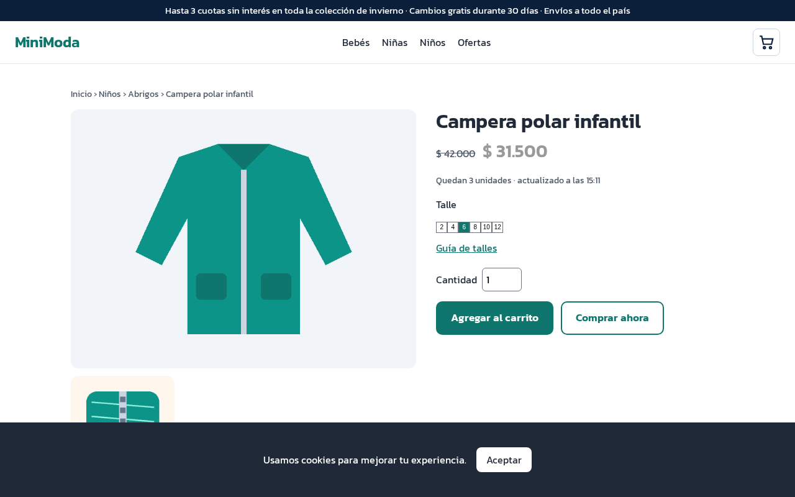
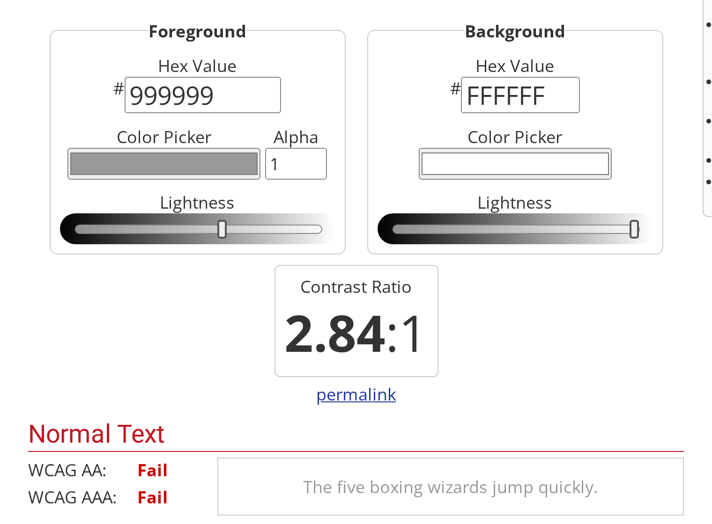
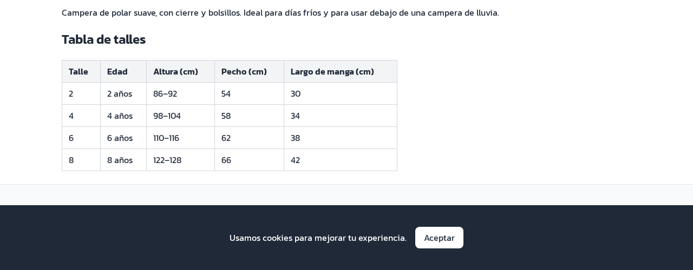
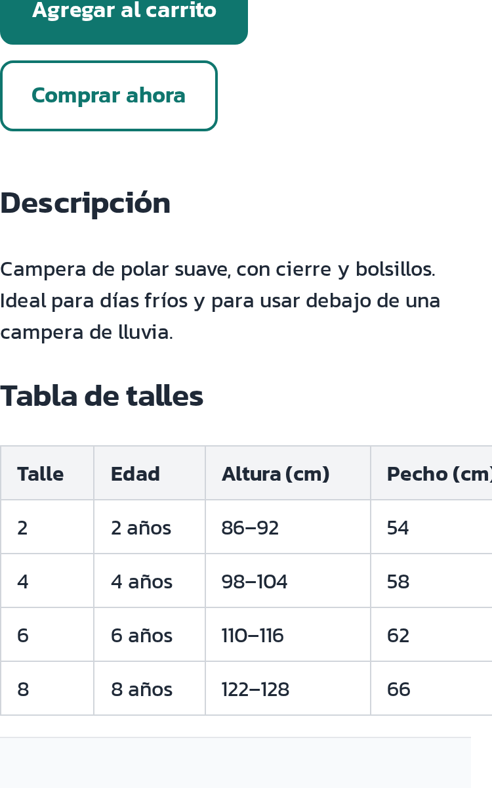
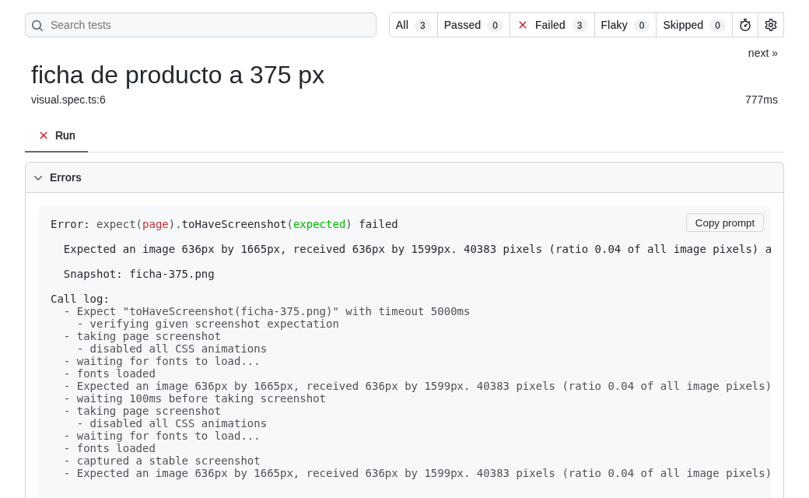

# Práctica · Clase 7 · Auditá y automatizá una ficha de producto

**TestingAI · AcademiaQA** · Testing de accesibilidad y testing visual y responsive con IA

Vas a trabajar sobre una ficha de producto de MiniModa que tiene errores de accesibilidad y visuales **puestos a propósito**. Primero la escaneás con una herramienta, después revisás a mano lo que la herramienta no ve, la probás en varios tamaños y con regresión visual, y terminás con issues y un PR.

**¿Por qué así?** Es la combinación que pide ISTQB CT-DAT (§3.2.2): prueba automática, manual y con tecnología de apoyo. Al final vas a poder comparar qué encontró la herramienta y qué encontraste vos.

## ¿Qué necesitás?

| Herramienta | ¿Para qué? |
|---|---|
| Chrome o Edge | DevTools, selector de color, modo dispositivo y Lighthouse |
| Node 20 o más y Playwright | Los dos tests. Usá el repo de la Clase 4, que ya tiene Playwright |
| `@axe-core/playwright` | El escaneo automático desde Playwright |
| Un lector de pantalla | NVDA o Narrador (Windows), VoiceOver (macOS) o TalkBack (Android). Con auriculares |
| Tu repo de GitHub | La rama, los issues y el PR |
| El chat o agente que uses | Ordenar resultados, describir capturas y redactar issues. Ninguno es obligatorio |

No hace falta crear ninguna cuenta nueva. Si no tenés Node, seguí el **camino corto** del final.

**Material:** el kit está en `practicas/clase-07/kit/` de este repo. LINK_PRACTICA

## ¿Qué tenés que validar a mano?

**La herramienta automática no ve esto.** Es la columna «Necesita una persona» de la clase (slide 10, «¿Qué prueba la IA y qué no?»). Revisalo sí o sí, aunque el escaneo dé 0 errores. Empezá por el lector de pantalla.

**1. Con VoiceOver o NVDA**

- ¿Cada botón dice qué hace? (por ejemplo, «Agregar al carrito», no solo «botón»).
- ¿El texto alternativo de cada imagen describe lo que muestra? (no el nombre del archivo).
- ¿El orden de lectura tiene sentido?
- ¿Cada campo se anuncia con su nombre y, si hay un error, con el mensaje?

**2. Con el teclado**

- ¿Ves siempre dónde está el foco?
- ¿El orden del foco sigue el orden de la página?
- ¿Podés salir de todo (ventanas, banners y menús) sin trabarte?

**3. Links**

- ¿Se entiende adónde va cada link, leído solo? (nada de «clic acá»).

**4. Zoom y celular**

- ¿Con zoom al 200 % y en un celular (375 px) se puede usar todo, sin desplazarse de costado?

## Paso 1 · Preparar (2 min)

**¿Qué hacés?** En tu repo de clases anteriores creás una rama nueva, copiás el kit y levantás la página.

```bash
git checkout -b clase-07-a11y
# copiá la carpeta kit/ dentro de clase-07/kit/
cd clase-07/kit
python3 -m http.server 5507
```

En otra terminal, en la raíz del repo: `npm i -D @axe-core/playwright`. En Windows, si `python3` no existe, probá `python` o `npx http-server -p 5507`.

**¿Por qué?** Una rama nueva suma esta capa sin tocar lo que ya hiciste, y deja todo listo para un PR. Los defectos son los mismos para todos: por eso cada uno trabaja en su repo y no en uno común.

**Listo si** `http://localhost:5507/` muestra la ficha «Campera polar infantil» y `http://localhost:5507/index-v2.html` muestra la versión 2.



**Términos:** rama, kit.

## Paso 2 · Escaneo automático (4 min)

**¿Qué hacés?** Le pedís a tu IA el test `clase-07/tests/a11y.spec.ts` con el **prompt 2**. Lo revisás antes de correrlo: la URL es la local, están las cinco etiquetas WCAG y el test falla si hay violaciones. Después lo corrés:

```bash
npx playwright test clase-07/tests/a11y.spec.ts
```

Si Playwright responde «No tests found», tu configuración busca en otra carpeta: creá `clase-07/playwright.config.ts` con `testDir: './tests'` (se lo podés pedir a tu IA) y sumá `--config clase-07/playwright.config.ts` a los comandos de este paso y de los pasos 6 y 7.

Sumá una segunda opinión: Lighthouse en DevTools (pestaña Lighthouse → Accesibilidad) o `npx pa11y --runner axe --runner htmlcs http://localhost:5507/` (pa11y pide Node 22.13 o más; es opcional). Guardá las salidas en `clase-07/resultados/`.

**¿Por qué?** El escaneo encuentra rápido lo que se puede comprobar con código. Es evidencia, no prueba de que la página sea accesible.

**Listo si** el test falla y en `clase-07/resultados/axe.json` hay violaciones con su regla y sus etiquetas. Así se ve la salida (real, del ensayo con axe-core 4.14.1):

```text
button-name (critical) · 1 elemento(s) · wcag2a, wcag412
color-contrast (serious) · 1 elemento(s) · wcag2aa, wcag143
...
  1 failed
```

**Términos:** escaneo automático, regla, etiqueta WCAG, violación, ítem incompleto.

## Paso 3 · Ordenar con IA (3 min)

**¿Qué hacés?** Pegás el JSON en tu chat con el **prompt 1**. La IA agrupa por criterio y marca A CONFIRMAR lo que depende del contexto. Después abrís la página y confirmás **dos** hallazgos; uno, de contraste, medido con el selector de color de las DevTools (o con el verificador de WebAIM).

**¿Por qué?** La IA ordena y explica, pero puede equivocarse (CT-DAT §6.1.2). Lo que no confirmás en la página no va al informe.

**Listo si** tenés dos hallazgos confirmados, con el valor de contraste medido.



**Términos:** criterio de conformidad, relación de contraste, A CONFIRMAR.

## Paso 4 · Teclado (5 min)

**¿Qué hacés?** Recorrés la página solo con el teclado (Tab, Shift+Tab, Enter, Espacio, flechas y Esc) y respondés las cinco preguntas: ¿llego a todo? (2.1.1), ¿veo dónde estoy? (2.4.7), ¿el orden tiene sentido? (2.4.3), ¿puedo salir de cada ventana? (2.1.2) y ¿el foco queda a la vista? (2.4.11). No aceptes el banner de cookies hasta terminar este paso.

**¿Por qué?** Casi nada de esto lo marca una herramienta automática. Es lo que más se escapa.

**Listo si** en la tabla del informe anotaste cada barrera con su criterio y cómo la encontraste.



**Términos:** foco, orden de foco, trampa de teclado.

## Paso 5 · Lector de pantalla (4 min)

**¿Qué hacés?** Activás tu lector de pantalla y escuchás tres cosas: el botón del carrito, la imagen principal y el mensaje que aparece al agregar al carrito (y el error del formulario de newsletter). Si no podés activar el lector, usá el árbol de accesibilidad de las DevTools (Elements → Accessibility) y anotalo.

**¿Por qué?** El lector dice lo que el código declara, no lo que se ve. Así aparecen nombres vacíos, textos alternativos inútiles y avisos que nadie escucha.

**Listo si** anotaste qué dijo el lector en cada caso y qué debería haber dicho, y repasaste la lista «¿Qué tenés que validar a mano?».

CAPTURA REAL PENDIENTE (lector de pantalla sobre la página de práctica).

**Términos:** lector de pantalla, nombre accesible, árbol de accesibilidad.

## Paso 6 · Tamaños y zoom (4 min)

**¿Qué hacés?** Le pedís a tu IA `clase-07/tests/visual.spec.ts` con el **prompt 3**: capturas de página completa en 375, 768 y 1280 px. Revisás las capturas. Después, en el navegador, probás el zoom al 200 % y un ancho de 320 px (modo dispositivo de las DevTools). Anotás lo que se rompe con su criterio (1.4.4 y 1.4.10). Si querés, pasale las capturas al chat con el **prompt 4** y confirmá cada diferencia.

**¿Por qué?** Una página puede funcionar en escritorio y romperse en el celular. El zoom y el reflow son también criterios de accesibilidad.

**Listo si** tenés la tabla de tamaños completa en el informe.



**Términos:** viewport, breakpoint, reflow, zoom.

## Paso 7 · Regresión visual (4 min)

**¿Qué hacés?** Generás las capturas de referencia con la versión 1 y comparás contra la versión 2:

```bash
npx playwright test clase-07/tests/visual.spec.ts --update-snapshots
PAGINA=http://localhost:5507/index-v2.html npx playwright test clase-07/tests/visual.spec.ts
npx playwright show-report
```

En Windows PowerShell: `$env:PAGINA="http://localhost:5507/index-v2.html"; npx playwright test clase-07/tests/visual.spec.ts`. En el reporte abrís cada diff y clasificás cada diferencia: **cambio esperado** (está en `notas-v2.md`) o **defecto**. No actualices la referencia con un defecto.

**¿Por qué?** La herramienta solo sabe que algo cambió. Vos decidís si estaba pedido.

**Listo si** cada diferencia tiene su clasificación en el informe. Así se ve el reporte (real, del ensayo):



**Términos:** regresión visual, captura de referencia, diff, umbral, máscara.

## Paso 8 · Issues y PR (4 min)

**¿Qué hacés?** Abrís **3 issues en tu repo**: 2 con la etiqueta `accesibilidad` y 1 con `visual`, con el **prompt 5** (formato de CT-DAT §4.3.2). Completás en el informe la columna «¿Lo detectó la herramienta?». Abrís el PR de `clase-07-a11y` a `main`, **sin mergear**, con los issues enlazados.

**¿Por qué?** Un hallazgo sin criterio, pasos y evidencia no se puede arreglar ni verificar. El PR abierto es tu pieza de portafolio: muestra criterio, no solo herramientas.

**Listo si** el PR tiene `informe-accesibilidad-visual.md`, los dos tests, las capturas, `resultados/` y los 3 issues enlazados.

CAPTURA REAL PENDIENTE (issue y PR de ejemplo).

**Términos:** issue, evidencia, impacto, PR.

## Camino corto (sin Node, con cualquier chat)

1. Levantá la página con `python3 -m http.server 5507` dentro de la carpeta del kit (o usá la página publicada, cuando esté: LINK_PRACTICA).
2. Escaneá con Lighthouse en DevTools o con la extensión gratis Accessibility Insights for Web (FastPass, sin cuenta).
3. Hacé los pasos 4 y 5 igual.
4. Sacá capturas en 375, 768 y 1280 px con el modo dispositivo de las DevTools, de las dos versiones, y compará a simple vista y con el chat (prompt 4).
5. Abrí los issues igual. Si vas atrasado, saltá el paso 7 y completalo después en la misma rama.

## Informe: `clase-07/informe-accesibilidad-visual.md`

- **Entorno:** sistema, navegador, lector de pantalla y versiones.
- **Hallazgos:** criterio WCAG, cómo se encontró (herramienta, teclado, lector o capturas), evidencia, impacto y «¿Lo detectó la herramienta?».
- **Visual:** tabla de 375, 768 y 1280 px y del zoom, y la clasificación de cada diff.
- **Conclusión:** qué cubrió la automatización y qué solo la revisión humana.

## Prompts (ejemplo; sirven para cualquier chat o agente)

**Prompt 1 · Resultados de axe → hallazgos agrupados**

```text
Sos QA de accesibilidad. Te paso el JSON de axe-core de una ficha de producto de una tienda online, analizada con WCAG 2.2 AA. Agrupá las violaciones por criterio de conformidad. Para cada grupo, indicá: regla de axe, criterio WCAG con número y nivel, elementos afectados (selector), impacto en las personas usuarias y cómo verificarlo a mano. Separá los ítems "incompletos" en otra lista. Si algo depende del contexto y no se puede afirmar desde el JSON, marcalo como A CONFIRMAR.
```

**Prompt 2 · Test de axe con Playwright**

```text
Escribí un test de Playwright en TypeScript, clase-07/tests/a11y.spec.ts, que abra http://localhost:5507/ (o la URL de la variable PAGINA), corra @axe-core/playwright con las etiquetas wcag2a, wcag2aa, wcag21a, wcag21aa y wcag22aa, guarde el resultado completo en clase-07/resultados/axe.json y falle si hay violaciones. Usá solo esas dependencias.
```

**Prompt 3 · Capturas en tres tamaños y regresión visual**

```text
Escribí clase-07/tests/visual.spec.ts: para los anchos 375, 768 y 1280 px, abrí la URL que llega en la variable PAGINA (por defecto http://localhost:5507/), desactivá animaciones, enmascará el elemento [data-dinamico] y compará con toHaveScreenshot de página completa, un nombre de captura por ancho y maxDiffPixelRatio: 0.001.
```

**Prompt 4 · Capturas → diferencias**

```text
Te paso dos capturas de la misma página en 375 px: la de referencia y la nueva, más las notas de la versión nueva. Listá cada diferencia visible con su ubicación. Para cada una, indicá si está en las notas (cambio esperado) o no (posible defecto) y si puede afectar la accesibilidad: contraste, tamaño del objetivo, foco o reflow. Marcá como A CONFIRMAR lo que no se distinga con claridad en la imagen.
```

**Prompt 5 · Hallazgo → issue**

```text
Con estos datos, redactá un issue de GitHub de accesibilidad con estas secciones: título, descripción, entorno (sistema, navegador, tecnología de apoyo y versiones), pasos para reproducir, resultado obtenido, resultado esperado, criterio WCAG 2.2 con número y nivel, impacto en las personas usuarias y evidencia. Usá frases cortas y no agregues datos que no estén en lo que te paso.
```

## Términos por paso

| Paso | Términos |
|---|---|
| 1 Preparar | rama, kit |
| 2 Escaneo | escaneo automático, regla, etiqueta WCAG, violación, ítem incompleto |
| 3 Ordenar con IA | criterio de conformidad, relación de contraste, A CONFIRMAR |
| 4 Teclado | foco, orden de foco, trampa de teclado |
| 5 Lector | lector de pantalla, nombre accesible, árbol de accesibilidad |
| 6 Tamaños y zoom | viewport, breakpoint, reflow, zoom |
| 7 Regresión visual | regresión visual, captura de referencia, diff, umbral, máscara |
| 8 Issues y PR | issue, evidencia, impacto, PR |

> **¿Usás una IA para hacer la práctica?** Pasale completo el archivo `practica-clase7-para-tu-agente.md` (está en esta misma carpeta). Tiene cada paso con su objetivo, qué hacer, el resultado esperado, cómo verificarlo y los errores comunes. La IA te ayuda; vos confirmás cada hallazgo en la página.
