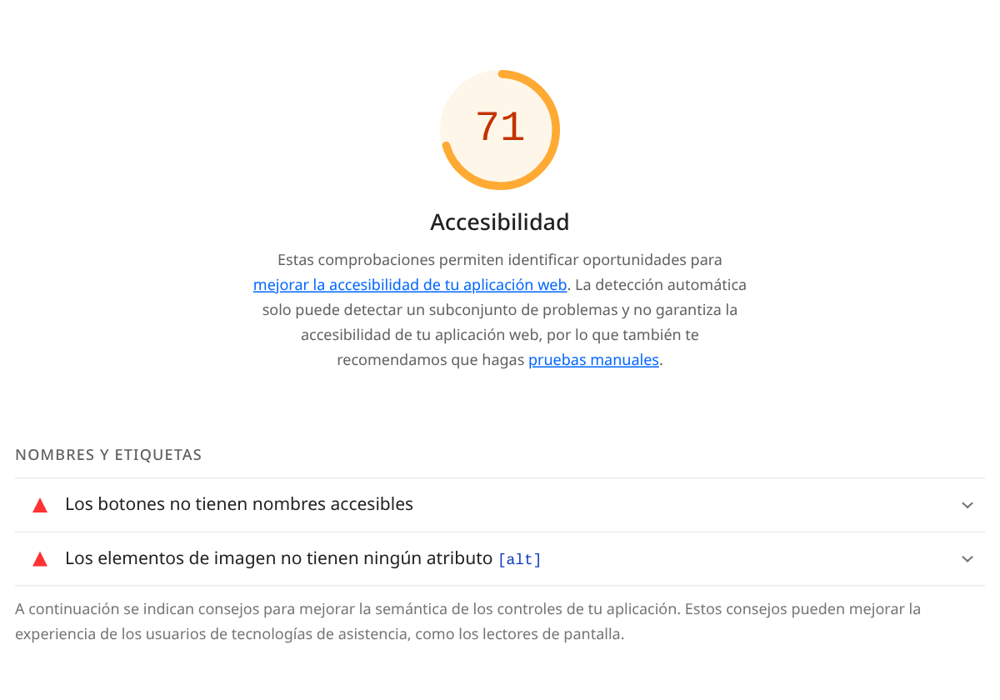
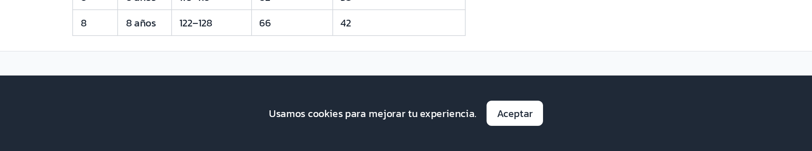
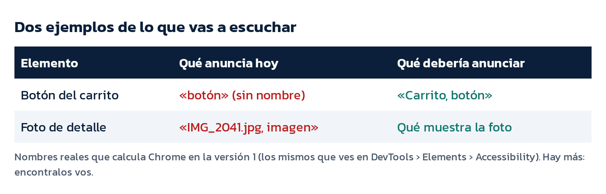
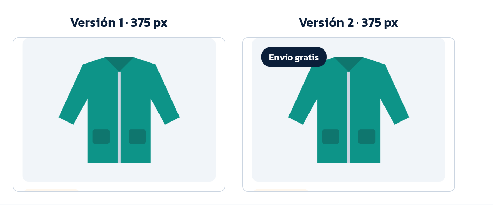
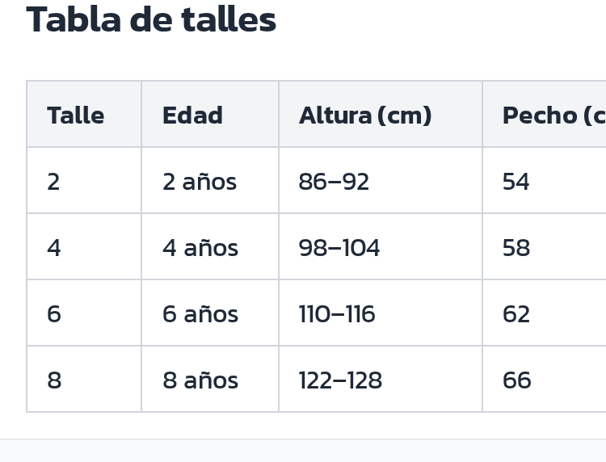
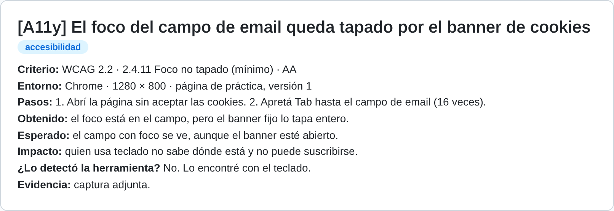

# Práctica · Clase 7 · Encontrá las barreras de una ficha de producto

**TestingAI · AcademiaQA** · Testing de accesibilidad y testing visual y responsive con IA

Vas a probar una ficha de producto de MiniModa. Tiene errores de accesibilidad y visuales **puestos a propósito**. Son 5 retos cortos, sin código. Tiempo: unos 30 minutos.

**Página de práctica:** [versión 1](https://simonethg.github.io/minimoda-test/practicas/clase-07/kit/) · [versión 2](https://simonethg.github.io/minimoda-test/practicas/clase-07/kit/index-v2.html) · [qué se pidió en la versión 2](https://github.com/Simonethg/minimoda-test/blob/main/practicas/clase-07/kit/notas-v2.md)

**¿Qué necesitás? Todo es gratis.**

- Chrome o Edge: ya traen Lighthouse y las DevTools.
- El lector de pantalla de tu compu: VoiceOver (Mac), Narrador o NVDA (Windows). Con auriculares.
- Tu chat de IA, en su versión gratis. Ninguno es obligatorio.
- Tu cuenta de GitHub, para abrir los issues en tu repo.

No instalás nada, no creás cuentas y no usás claves. No pegues datos personales en el chat.

**La regla de la clase:** la herramienta encuentra una parte. Vos confirmás todo en la página. Lo que no confirmaste no va al informe.

## Reto 1 · Escaneá con Lighthouse (5 min)

1. Abrí la versión 1. Apretá F12 y entrá a la pestaña **Lighthouse**.
2. Marcá solo **Accesibilidad** y tocá **Analizar la carga de la página**.
3. Copiá la lista de errores y pasásela a tu IA con este prompt.

```text
Sos QA de accesibilidad. Te paso los errores que marcó Lighthouse en una página de práctica. Armá una tabla con: qué significa cada error en palabras simples, el criterio WCAG 2.2 y su nivel, y qué tengo que mirar en la página para confirmarlo. No inventes errores que no estén en la lista. Errores: [pegá acá la lista]
```

**Lo que vas a ver:** un puntaje menor a 100 y varios errores. Confirmá dos en la página.



## Reto 2 · Recorré la página con el teclado (5 min)

1. Recargá la página. **No aceptes las cookies** todavía.
2. Usá solo Tab, Shift+Tab, Enter, Espacio y Esc. Abrí la «Guía de talles» y cerrala.
3. Anotá dónde no ves el foco, qué no podés usar y de qué no podés salir.

```text
Hice una prueba solo con el teclado en una ficha de producto. Te paso lo que anoté. Ordenalo en una tabla con: barrera, criterio WCAG 2.2 (2.1.1, 2.1.2, 2.4.3, 2.4.7 o 2.4.11), cómo la encontré y a quién afecta. Si algo no encaja en esos criterios, marcalo A CONFIRMAR. Mis notas: [pegá acá]
```

**Lo que vas a ver:** en algún momento el foco desaparece. Por ejemplo, acá está en el campo de email, pero el banner de cookies lo tapa.



## Reto 3 · Escuchá la página con un lector de pantalla (5 min)

1. Activá el lector: VoiceOver con Cmd+F5 (Mac) o Narrador con Ctrl+Win+Enter (Windows).
2. Recorré con Tab el carrito, las fotos, «Agregar al carrito» y el campo de email.
3. Anotá qué dice y qué debería decir. Sin lector, usá F12 › Elements › Accessibility.

```text
Probé una página con un lector de pantalla. Te paso qué anunció en cada elemento. Para cada uno, decime qué debería anunciar, qué criterio WCAG 2.2 no se cumple y cómo se arregla en HTML, en una línea. Mis notas: [pegá acá]
```

**Lo que vas a ver:** botones sin nombre e imágenes con textos que no sirven.



## Reto 4 · Celular, zoom y versión 2 (7 min)

1. Con F12, activá el modo dispositivo (Ctrl+Shift+M; Cmd+Shift+M en Mac) en 375 px. Después probá el zoom al 200 %.
2. Abrí la versión 2 en 375 px y leé qué se pidió en la versión 2.
3. Sacá una captura de cada versión y pasáselas a tu IA con este prompt.

```text
Te paso dos capturas de la misma página en 375 px: la versión 1 y la versión 2. El único cambio pedido fue un banner «Envío gratis» sobre la foto. Listá todas las diferencias que ves y marcá cuáles no se pidieron. No supongas nada que no se vea en las capturas.
```

**Lo que vas a ver:** el banner pedido aparece. Buscá lo que cambió sin que nadie lo pidiera, y lo que obliga a desplazarse de costado.





## Reto 5 · Contá lo que encontraste (8 min)

1. Armá una tabla: hallazgo, criterio WCAG, cómo lo encontraste y si lo detectó Lighthouse.
2. Pedile a tu IA 3 issues con este prompt: 2 de accesibilidad y 1 visual.
3. Revisá cada issue y abrilo en tu repo de GitHub con la etiqueta `accesibilidad` o `visual`.

```text
Con esta tabla de hallazgos, redactá 3 issues para GitHub: 2 de accesibilidad y 1 visual. Cada uno con: título corto, criterio WCAG 2.2, entorno, pasos, resultado obtenido, resultado esperado, impacto y si lo detectó la herramienta. No agregues hallazgos que no estén en la tabla. Tabla: [pegá acá]
```

**Lo que vas a ver:** issues cortos, con criterio y evidencia, como este.



## Tu entrega

- La tabla de hallazgos, con la columna «¿Lo detectó Lighthouse?».
- 3 issues en tu repo de GitHub: 2 de accesibilidad y 1 visual.

**¿Querés trabajar sin internet?** Descargá el [kit en zip](https://github.com/Simonethg/minimoda-test/releases/download/kit-clase-7/kit-accesibilidad-minimoda.zip), descomprimilo y abrí `index.html` en el navegador. Para el reto 1 usá la página publicada: Lighthouse no analiza archivos locales.
